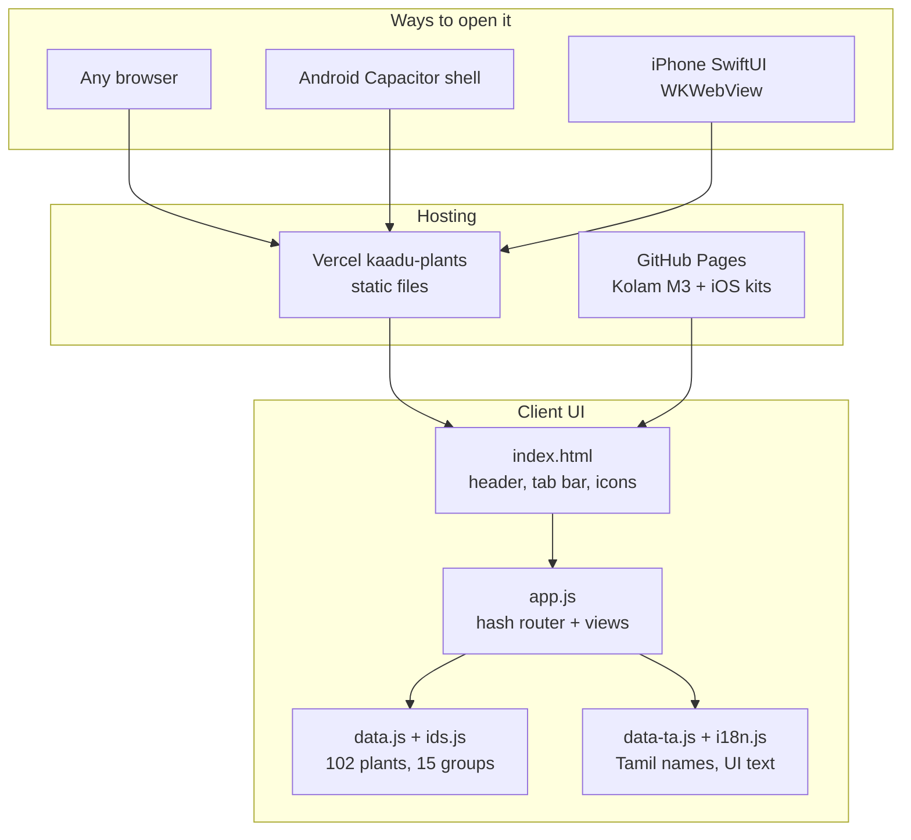
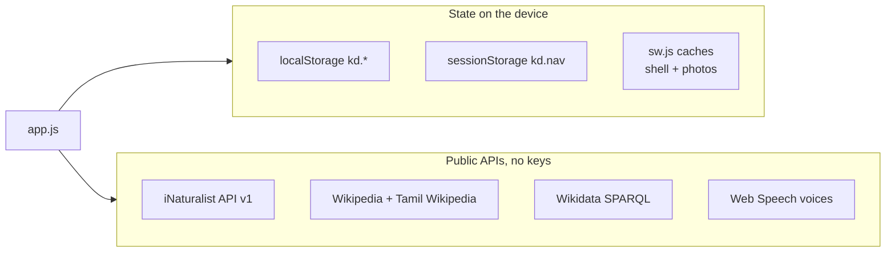
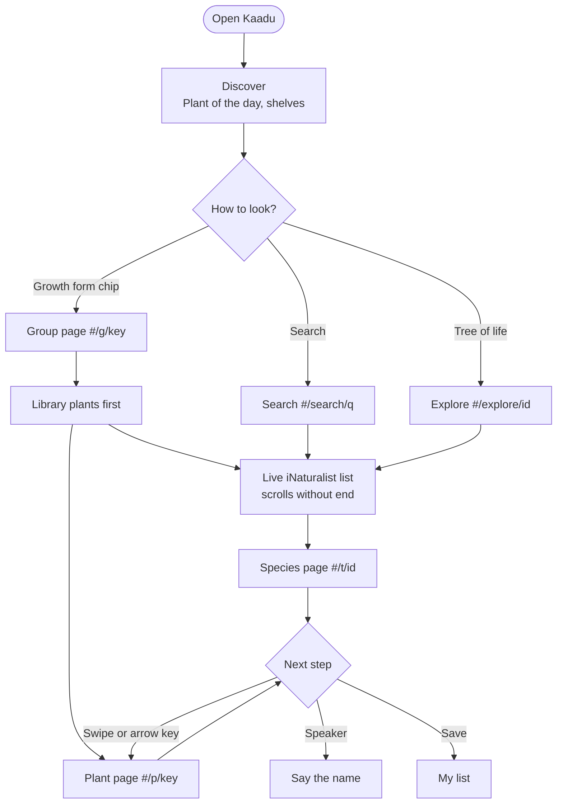
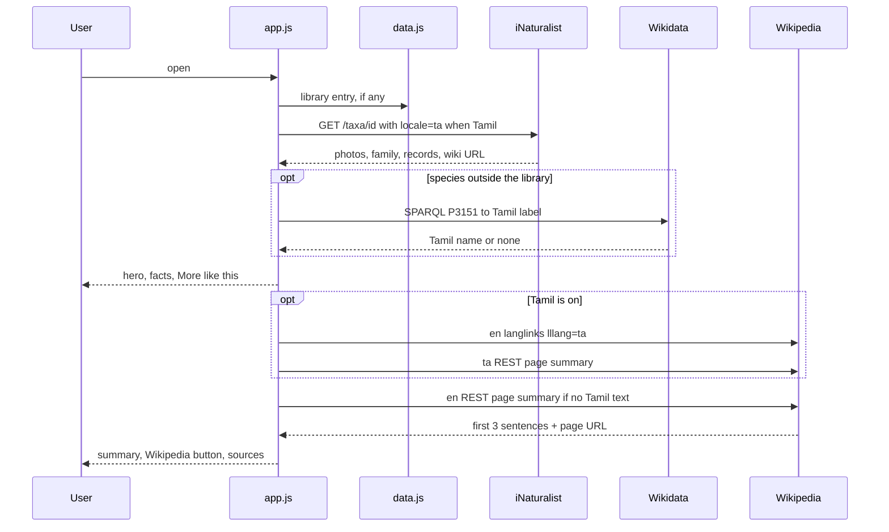
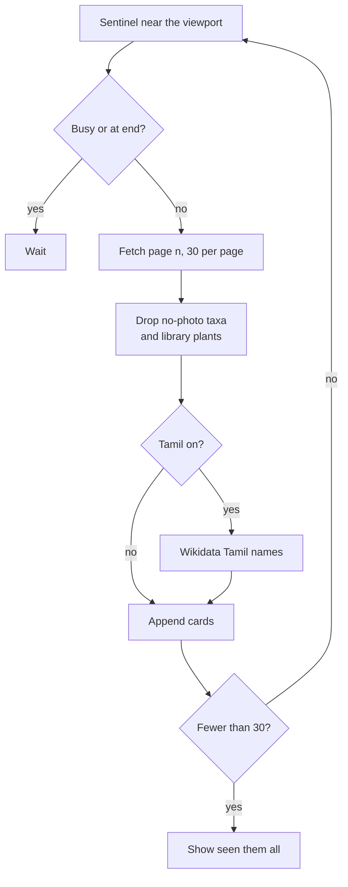
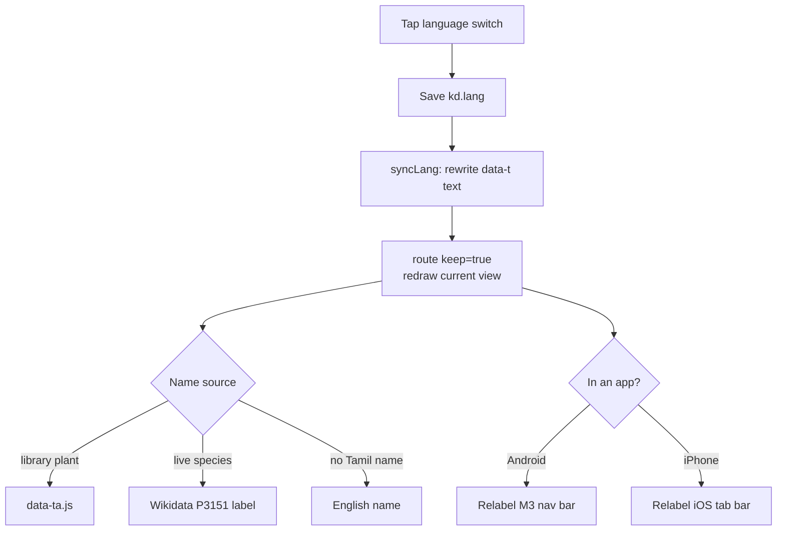
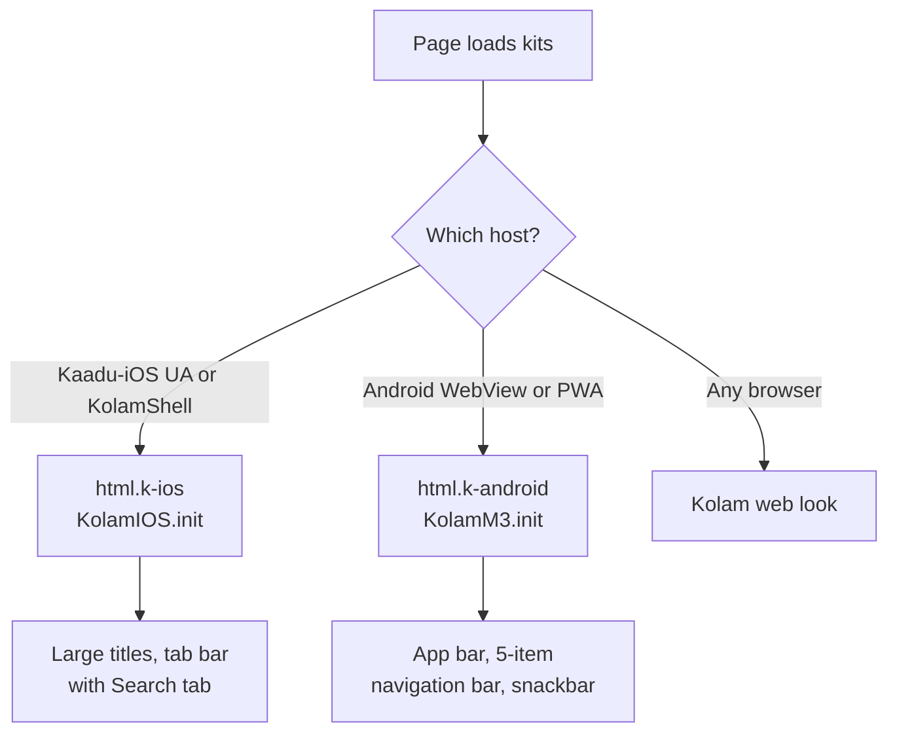
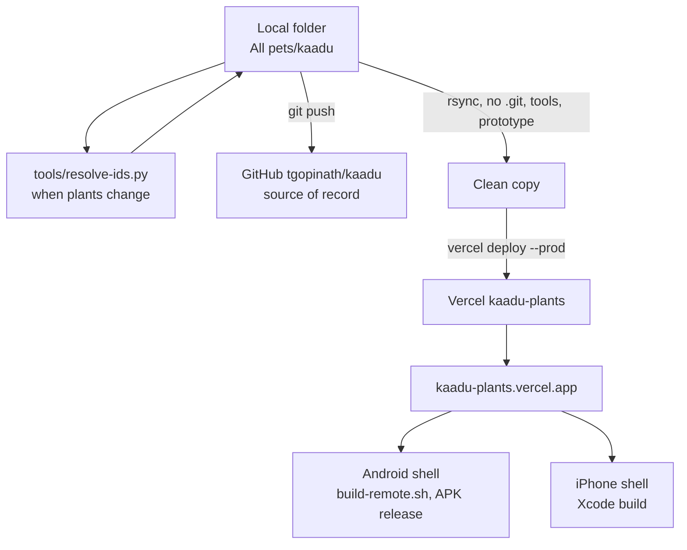

# Kaadu (காடு): architecture

Kaadu is a field guide to every kind of plant, grouped by how it grows: trees, shrubs, vines, herbs, grasses, ferns, succulents, water plants, mosses, palms and conifers, plus fruits and vegetables. It works in English and Tamil. The main idea is a small hand-written library of 102 well-known plants, many from India and Tamil Nadu, with live data from iNaturalist, Wikipedia and Wikidata added around it. Because of that, every list goes on past the library to every recorded species. There is no backend and no build step. The same static site is the website, the Android app and the iPhone app.

| Platforms | Stack | Data | Hosting |
| --- | --- | --- | --- |
| Web PWA, Android (Capacitor shell, remote), iPhone (SwiftUI WKWebView shell) | Plain HTML, CSS and ES modules, Kolam design system, no framework, no build | 102 library plants in `data.js`, live iNaturalist, Wikipedia, Tamil Wikipedia, Wikidata | Vercel project `kaadu-plants`, static files, deployed from the CLI |

## System architecture

The browser does all the work. `index.html` loads the Kolam stylesheets, the app's own `styles.css`, the Kolam M3 and iOS kits from GitHub Pages, and one ES module, `app.js`. `app.js` imports the plant library (`data.js`, which imports the taxon IDs in `ids.js`), the Tamil names (`data-ta.js`) and the interface text (`i18n.js`). It then talks straight to public, keyless APIs from the browser. A hash router picks the view, and each view writes HTML into one `<main id="app">` element.

*One static site, three ways to open it. Both native shells load the live URL.*

From there, `app.js` keeps its state on the device and fetches all live data itself from public APIs.

*No backend of its own: storage is local, APIs are called from the browser.*

## Main user flow

The core job is to find a plant and learn about it. Someone opens Discover and sees the Plant of the day. They pick a growth form or search, then open a plant page. On the plant page they can swipe to the next plant, hear the name spoken, or save the plant to My list.

*Library plants open at `#/p/<key>`. Any other species opens at `#/t/<iNaturalist id>`. If that id belongs to a library plant, the router sends it to the library page instead.*

### Routes

| Hash route | View |
| --- | --- |
| `#/` | Discover: Plant of the day banner, Recently viewed, My list, Top plants in India, a shelf per growth form, then the full library and the live list |
| `#/g/<group>` | One growth form: its library plants (A to Z bar when there are more than 6), then the live list for that group |
| `#/types` | Plant types: a tile per group with its blurb and library count |
| `#/explore/<id>` | Tree of life: child taxa of a branch, most recorded first, with breadcrumbs from the plant kingdom (iNaturalist 47126) |
| `#/game/<mode>` | Games hub and six games: Name it, Which type?, Odd one out, Find it, Memory match, Fruit or vegetable? |
| `#/search/<q>` | Library matches (name, scientific name, family, Tamil name, group) and then iNaturalist autocomplete results |
| `#/saved` | My list |
| `#/p/<key>`, `#/t/<id>` | Plant page: photo slides, name and speaker, Save, Wikipedia link, facts, growth forms, More like this |

## Data flow and state

A plant page is put together from up to four sources. The library entry gives the hand-written facts. iNaturalist gives photos, the family, the record count and the Wikipedia title. Wikidata gives a Tamil name for species outside the library. Wikipedia, or Tamil Wikipedia when Tamil is on, gives a three-sentence summary. Each step checks that the page is still the one on screen before it writes, so a fast swipe never shows the wrong plant.

*The page draws as soon as iNaturalist answers. The Wikipedia summary fills in afterwards.*

### Where state lives

| Key / place | What it holds |
| --- | --- |
| `kd.lang` | Interface language, `en` or `ta` |
| `kd.saved` | My list: an array of `{h, n, sci, img}` (route, name, scientific name, photo), newest first |
| `kd.recent` | Recently viewed plant pages, newest first, last 20 |
| `kd.scope` | Live list scope: `india` (iNaturalist place 6681) or `world` |
| `kd.lib.v2` | Library photo URL, attribution and record count per taxon id, kept for one day |
| `kd.ta.v1` | Wikidata Tamil names by iNaturalist id, including misses so they are not asked again |
| `kd.score.<mode>` | Game stars, games played and streak, one key per game |
| `kd.swipeHint` | Whether the swipe tip has been shown |
| `kd.memory.best` | Fewest moves in the Memory match game |
| `sessionStorage kd.nav` | The list the last plant was opened from, used for previous and next |
| In memory | `memo` map of iNaturalist promises (one request per path per session), the current game round |
| Cache Storage | `kd-shell-v10-ios` (app files, fonts, Kolam kits) and `kd-img-v1` (iNaturalist photos) |

Nothing leaves the device apart from the API requests. There are no accounts and no server.

### Live lists that scroll without end

Group lists, the home list and the tree of life use the same pattern. An `IntersectionObserver` watches a sentinel with an 800 px margin, and each load asks for 30 more. Group lists call `/observations/species_counts` with the group's taxon ids, `quality_grade=research`, `photos=true` and, for India, `place_id=6681`. Library plants are skipped so they do not show twice. The tree of life calls `/taxa?parent_id=…&order_by=observations_count`. If the sentinel is still on screen after a page loads, the next page loads straight away. A failed page shows Try again in place.

### Switching language

The language switch sits in the Profile panel. It saves `kd.lang`, rewrites every element marked `data-t`, `data-t-ph` or `data-t-label`, and re-runs the router in place, keeping the scroll position. Library plants use the hand-written Tamil names. Live species use Wikidata. When a name has no Tamil form, it stays in English. Inside the apps, the M3 navigation bar and iOS tab bar are relabelled, and two long Tamil labels get shorter words.

## Key modules

| File / module | Responsibility |
| --- | --- |
| `index.html` | Header with search, profile panel and language switch, the phone tab bar, an inline SVG icon sprite (line icons and one per growth form), kit loading |
| `app.js` | About 1,070 lines. Hash router, every view, iNaturalist access with a promise cache, infinite lists, Wikipedia and Wikidata lookups, Web Speech, My list, games (Web Audio tones, confetti, haptics), swipe and arrow-key previous and next, and the Android and iPhone app modes |
| `data.js` | 15 groups (All plants, 13 growth forms with fruits and vegetables, and Flowering plants), each with the iNaturalist taxa its live list draws from, plus 102 hand-written plants with family, height, habitat, native range, uses and a short bio |
| `ids.js` | 250 iNaturalist taxon ids by scientific or group name, generated by `tools/resolve-ids.py` |
| `data-ta.js` | Tamil names for all 102 library plants |
| `i18n.js` | 162 interface strings in English and Tamil, Tamil group names, group blurbs, rank names |
| `styles.css` | The app's dark look on top of Kolam, plus overrides for `html.k-android` and `html.k-ios` |
| `kolam/` | A copy of the Kolam design system's `tokens.css` and `kolam.css` |
| `sw.js` | Service worker: network first for the app shell, cache first for iNaturalist photos |
| `tools/resolve-ids.py` | Looks up every name in `data.js` on iNaturalist (using curl) and rewrites `ids.js` |
| `tools/shots.mjs` | Headless Chrome screenshots at 390 px for the portfolio card, saved to `prototype/shots` |

Note: the plant count in the repo README (70) is out of date. The code has 102 library plants.

## Platforms

### Web and PWA

In a browser, Kaadu uses the Kolam design system with its own dark palette: Inter, flat cards with the name and a speaker over the photo, and a cinematic plant page. `index.html` sets `data-theme="dark"`. A manifest makes it installable as a standalone app. The header becomes a bottom tab bar on phones.

### Android

The Android app is a Capacitor shell in `android-wrappers/kaadu`, app id `com.gopinath.kaadu`. It is a remote shell: `capacitor.config.json` sets `server.url` to the live site, so the app is always current. `MainActivity` is a plain `BridgeActivity`, and the bundled `www` page only says the app needs the internet. It is built with `android-wrappers/build-remote.sh`, which uploads `kaadu.apk` to the repo's GitHub release.

Inside it, `kolam-m3.js` adds `html.k-android`. It does this in a Capacitor Android WebView, an installed Android PWA, or with `?app=android`. `app.js` then calls `KolamM3.init` with the Kaadu green, a top app bar with a profile action, and a five-destination navigation bar: Discover, Explore, Games, Search and My list. It hides the web tab bar, sends toasts through the M3 snackbar and haptics through `KolamM3.haptic`, and lets the system Back button close the profile panel or search first.

### iPhone

The iPhone app is in `Kaadu-iOS` (repo `tgopinath/Kaadu-iOS`). It is a SwiftUI app for iOS 17 and later, with a `WKWebView` that loads the live site. It adds `Kaadu-iOS/1.0 Kolam-iOS/1.0` to the user agent and injects `window.KolamShell`. It also allows edge-swipe back, opens outside links in Safari's viewer, shows an offline screen with Try Again, and turns `haptic` messages from the page into iOS haptics.

`kolam-ios.js` sees the shell and adds `html.k-ios`. `app.js` then calls `KolamIOS.init` with large titles on the main tabs and Back plus a centred title on inner pages, where the Back label names the tab it returns to. It also sets up a tab bar with four tabs and a trailing Search tab, and moves the search field under the bar. `?app=ios` forces this look in a browser for testing.

*iOS is checked first. If it matches, `app.js` removes the Android classes.*

## Data sources and APIs

| Source | Used for | Licence / key |
| --- | --- | --- |
| Hand-written library (`data.js`, `data-ta.js`) | 102 plants: names, Tamil names, growth forms, family, height, habitat, native range, uses, bio | App content, no key |
| iNaturalist `/taxa/<ids>` | Library photos in batches of 30, and plant page details (photos, ancestors, record count, Wikipedia URL) | Public API, no key; photo attribution shown under each photo |
| iNaturalist `/observations/species_counts` | Group lists and the home Top plants in India shelf (Plantae 47126, place 6681) | Public API, no key |
| iNaturalist `/taxa/autocomplete` | Search, limited to plants, Tamil locale when Tamil is on | Public API, no key |
| iNaturalist `/taxa?parent_id=` | Tree of life branches, most recorded first | Public API, no key |
| Wikipedia REST `page/summary` | Three-sentence summary and the Wikipedia button, English or Tamil | CC BY-SA text, no key |
| Wikipedia `api.php` langlinks | Finding the Tamil Wikipedia title for an English article | No key |
| Wikidata SPARQL | Tamil labels for species by iNaturalist id (property P3151) | CC0, no key |
| Web Speech API | Saying names aloud with an `en-IN` or `ta-IN` voice, rate 0.9 | On-device voices; a toast if none |
| Kolam kits on GitHub Pages | M3 and iOS app looks | Gopinath's own design system |

## Offline, performance, privacy and accessibility

**Offline.** `sw.js` pre-caches the app files and serves them network first, falling back to the cache. Google Fonts and the Kolam kit files are cached the same way. iNaturalist photos are cached as they are seen, so library plants and saved plants still show photos offline. Live lists, search and summaries need a connection, and they show a clear message with Try again. The service worker is not registered on localhost. Both native shells load the live site, so they need the internet to start.

**Performance.** No framework and no build. `vercel.json` sends `no-cache` for the app files, so updates show on the next load. Library photos and Tamil names are cached on the device. The same iNaturalist path is never fetched twice in a session. Images load lazily and request the size they need (square, small, medium or large).

**Privacy.** No accounts, analytics or server. My list, scores and settings stay in `localStorage`. API requests carry only plant ids and search text.

**Accessibility.** A skip link, a labelled language switch with `role="switch"`, `aria-current` on tabs and filters, live regions for list loading and game feedback, and alt text on plant photos. Tamil text carries `lang="ta"` so screen readers and fonts (Noto Sans Tamil) handle it. Swipe and slide animations respect `prefers-reduced-motion`. Previous and next also work with the arrow keys.

## Build and deploy

There is no build. The repo is plain static files. The Vercel project `kaadu-plants` is not connected to git. The Vercel API shows no git link, and the deployments carry no commit. Deploys are made with the Vercel CLI from a git-free copy of the folder, which leaves out `.git`, `prototype` and `tools`. So pushing to GitHub does not change the live site. The native shells pick up a new web deploy on their next launch without a rebuild.

*GitHub and Vercel are updated separately. The shells only need rebuilding when the shell itself changes.*

To change the service worker cache, bump `SHELL` in `sw.js`, as was done for `kd-shell-v10-ios`. After adding plants or groups, run `tools/resolve-ids.py` so `ids.js` has their taxon ids.

## Known limits and next steps

- Tamil bios are not written yet. In Tamil, library plants show the Tamil Wikipedia summary, or the English bio when there is none. Hand-written facts (height, habitat, uses) are English only.
- Tree, shrub, vine, herb, fruit and vegetable lists are approximations. These forms are not single branches of the tree of life, so their live lists draw on families and genera that are almost all of that form, and the app says so.
- iNaturalist search returns genera and families as well as species. It is not filtered to species.
- Live lists, search and summaries need a connection, and both native shells need one to start.
- Name pronunciation depends on the voices installed on the device. Many devices have no Tamil voice.
- The README's plant count (70) is out of date. The code has 102.
- Deploys are manual CLI runs. Connecting `kaadu-plants` to the GitHub repo would make a push enough.

---

Written from the source code on 17 November 2026. Source: [github.com/tgopinath/kaadu](https://github.com/tgopinath/kaadu)
